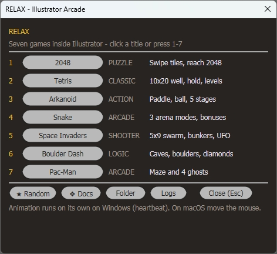

# ExtendScript Games for Adobe Illustrator

Seven complete games that run **inside Adobe Illustrator** — pure ExtendScript (ES3) + ScriptUI, drawn pixel by pixel with `ScriptUIGraphics`, no raster assets, no plugins.

The games are the visible part. The real subject of this repository is **what the Illustrator scripting engine can actually do**: no timers, no fonts you can trust, no JSON, no frameworks — and still a real-time loop, a vector font renderer, a four-language UI and one-click export of the game scene to an editable artboard.

> Treat this as a capability test of ExtendScript for Illustrator, not as a shipped product.

---

## What it demonstrates

| Capability | How it is done | Where |
|---|---|---|
| **Real-time animation without timers** | Illustrator has no `setInterval`. A hidden PowerShell process compiles a small C# class (`Add-Type`) and posts `WM_MOUSEMOVE` + `F15` to the dialog every 25–40 ms, waking the ExtendScript engine. | [`lib/GameHeartbeat.jsx`](lib/GameHeartbeat.jsx) |
| **Own vector font** | `Graphics.drawString()` miscalculates baseline and metrics on Windows. Every glyph is built from two primitives — a round-capped capsule and an arc band — and centred mathematically. Zero `drawString` calls in the codebase. | [`lib/GameCore.jsx`](lib/GameCore.jsx), per-game `drawVectorGlyph` |
| **Immediate-mode rendering** | Rounded rectangles via 16-point trigonometric approximation (there are no Bézier curves), geometric circles, diamonds and 2.5D blocks. Static geometry is batched into a single `fillPath` — the Boulder Dash cave went from ~1200 fills per frame to 13. | [`lib/GameCore.jsx`](lib/GameCore.jsx) |
| **Smooth motion on a cell grid** | Logic steps 6–7 times per second; the canvas repaints at ~30 fps with interpolated positions, so sprites glide between cells instead of jumping. Teleports (warp tunnels, eaten ghosts) are deliberately not animated. | [`lib/GameAnim.jsx`](lib/GameAnim.jsx) |
| **Four-language UI** | English, Czech, Romanian and Hindi dictionaries in every game, including Devanagari. Illustrator decodes a BOM-less `.jsx` as Windows-1252, so encoding is part of the build contract. | per-game `I18N`, [`lib/GameI18n.jsx`](lib/GameI18n.jsx) |
| **Persistence without JSON** | `JSON` does not exist in ES3. Saves and settings are `key=value` lines in `Folder.userData`, written through a small shared helper. | [`lib/GamePersist.jsx`](lib/GamePersist.jsx) |
| **Export to an editable artboard** | The current frame becomes real Illustrator paths and text on a new layer, with the Y axis inverted (ScriptUI grows downwards, the DOM grows upwards). | each game's `export…ToArtboard()` |
| **Static verification** | A Node gate resolves `#include`, compiles the fully inlined script, rejects ES5+ syntax, checks the BOM rules and i18n key parity; a second tool runs the drawing core in a sandbox with a fake `ScriptUIGraphics`. | [`tools/check.js`](tools/check.js), [`tools/test-core.js`](tools/test-core.js) |
| **Runtime diagnostics** | Every game writes a frame-timing log (status label / hide-show / drawing) to `%TEMP%\relax_log_<Game>.txt`, which is how the 6–7 fps cadence was measured and fixed. | [`lib/GamePerf.jsx`](lib/GamePerf.jsx) |
| **Launcher without `#include` support** | `$.evalFile()` is not documented to preprocess `#include`, so the launcher inlines the sources itself into a temporary single-file bundle and runs that. | [`Play Arcade.jsx`](Play%20Arcade.jsx) |

## Screenshots

| Launcher | 2048 |
|---|---|
|  |  |

| Arkanoid | Snake |
|---|---|
|  |  |

| Space Invaders | Boulder Dash |
|---|---|
|  |  |

| Pac-Man | Tetris |
|---|---|
|  | *screenshot pending* |

## The games

| Game | File | Genre | What is interesting in it |
|---|---|---|---|
| **2048** | `2048.jsx` | Puzzle | Swipe gestures, tile merging, full game state restored between sessions |
| **Tetris** | `Tetris.jsx` | Classic | 7-bag randomizer, wall kicks, ghost piece, hold/next preview, smooth falling piece |
| **Arkanoid** | `Arkanoid.jsx` | Action | Continuous physics, 5 stages, 5 power-up capsules, lasers, mouse-driven paddle |
| **Snake** | `Snake.jsx` | Arcade | Turn queue, 3 arena modes (walls / portals / labyrinth), gradient body |
| **Space Invaders** | `SpaceInvaders.jsx` | Shooter | 5×9 swarm with two-frame animation, eroding bunkers, mystery UFO |
| **Boulder Dash** | `BoulderDash.jsx` | Logic | Cell gravity for boulders and gems, monster AI, 5 hand-built caves |
| **Pac-Man** | `PacMan.jsx` | Arcade | 19×21 maze, four ghosts with different personalities, frightened mode |

## Quick start

1. Download or clone this repository (**keep the folder intact — the games share `lib/`**).
2. In Illustrator open `File > Scripts > Other Script…` and pick **`Play Arcade.jsx`**.
3. Click a game title or press `1`–`7`. Closing a game brings the launcher back.

Running a single game directly works too: `File > Scripts > Other Script…` → e.g. `Tetris.jsx`.

**Controls:** arrows / WASD to move, `Space` for the primary action, `Esc` to close. Mouse steers in Arkanoid and Space Invaders; swipes and clicks work in 2048, Snake, Boulder Dash and Tetris.

## How it works

The full engineering notes — including the platform traps that shaped this code — are in **[EXTENDSCRIPT_GAME_DEV_GUIDE.md](EXTENDSCRIPT_GAME_DEV_GUIDE.md)**. Short version:

- **No timer in Illustrator.** A PowerShell process posts synthetic events into the modal dialog; the game reacts to them. It keeps running while Illustrator is in the background, pauses when the window is minimised, and never moves the real cursor unless the game window has focus.
- **No trustworthy text rendering.** Everything on the canvas is geometry; ScriptUI `statictext` is used only for labels outside the canvas.
- **ES3 only** — `var`, loops, no `let`/`const`, no `JSON`, no `Array#forEach`. A static gate enforces this.
- **Encoding matters.** Entry scripts are UTF-8 **with BOM**; included `lib/` files are ASCII and BOM-less.

## Repository layout

```
Play Arcade.jsx      launcher: menu for all games (1-7, Random, Docs, Logs)
2048.jsx … Tetris.jsx  seven games
lib/                 shared engine: drawing core, heartbeat, animation, persistence, i18n, diagnostics
tools/               static gate, core tests, mechanical refactoring helper
screenshots/         UI captures used in this README
README.md            this file
TESTING.md           test plan: coverage matrix, cases A-01 … K-03, acceptance checklist
AGENTS.md            conventions for contributors
EXTENDSCRIPT_GAME_DEV_GUIDE.md  the engineering write-up
```

## Verification

```powershell
node tools/check.js        # ES3 syntax, #include resolution, UTF-8 BOM rules, i18n key parity
node tools/check.js --fix  # repair BOM problems in place
node tools/test-core.js    # drawing core, {0} substitution, save parsing, heartbeat generation
```

Both run on Node alone — Illustrator is not required. The runtime test is manual: see [TESTING.md](TESTING.md) (Smoke run ≈ 25 min, Full run ≈ 2.5 h).

## Requirements and known limitations

- **Adobe Illustrator 2021+** — developed and tested on Illustrator 2026 (Windows, ES3 engine).
- **Windows** for autonomous animation. On macOS the heartbeat is unavailable: the game still runs, but advances only while the mouse moves, and the status bar says so.
- Corporate machines may block `powershell.exe -ExecutionPolicy Bypass` or `wscript.exe`; the game then reports that the timer is unavailable instead of silently freezing.
- The games are modal dialogs by design — that is the only reliable way to keep an ExtendScript window alive.
- No licence file yet: the code is published for reference and evaluation.

## Documentation

- **[EXTENDSCRIPT_GAME_DEV_GUIDE.md](EXTENDSCRIPT_GAME_DEV_GUIDE.md)** — the platform traps and the recipes that solve them (timer, vector font, batching, interpolation, encoding, export). Written in Russian.
- **[TESTING.md](TESTING.md)** — test plan with case IDs and an acceptance checklist. Written in Russian.
- **[AGENTS.md](AGENTS.md)** — coding conventions, encoding contract, review expectations.
