# ExtendScript Games for Adobe Illustrator

> **Play online (GitHub Pages):** https://shafranek-js.github.io/ExtendScript-games-for-Illustrator/

Twelve complete games that run **inside Adobe Illustrator** (pure ExtendScript ES3 + ScriptUI, drawn pixel by pixel with `ScriptUIGraphics`, no raster assets, no plugins) — and now also **live in your browser** via a lightweight Canvas 2D ScriptUI runtime on **[GitHub Pages](https://shafranek-js.github.io/ExtendScript-games-for-Illustrator/)**.

The games are the visible part. The real subject of this repository is **what the Illustrator scripting engine can actually do**: no timers, no fonts you can trust, no JSON, no frameworks — and still a real-time loop, a vector font renderer, a four-language UI and one-click export of the game scene to an editable artboard.

> Treat this as a capability test of ExtendScript for Illustrator, not as a shipped product.

---

## What it demonstrates

| Capability | How it is done | Where |
|---|---|---|
| **Real-time animation without timers** | Illustrator has no `setInterval`. A hidden PowerShell process compiles a small C# class (`Add-Type`) and posts `WM_MOUSEMOVE` + `F15` to the dialog every 25–40 ms, waking the ExtendScript engine. | [`lib/GameHeartbeat.jsx`](lib/GameHeartbeat.jsx) |
| **Own vector font** | `Graphics.drawString()` miscalculates baseline and metrics on Windows. Every glyph is built from two primitives — a round-capped capsule and an arc band — and centred mathematically. Zero `drawString` calls in the codebase. | [`lib/GameCore.jsx`](lib/GameCore.jsx), per-game `drawVectorGlyph` |
| **Immediate-mode rendering** | Rounded rectangles via 16-point trigonometric approximation (there are no Bézier curves), geometric circles, diamonds and 2.5D blocks. Static geometry is batched into a single `fillPath` — the Boulder Dash cave went from ~1200 fills per frame to 13. | [`lib/GameCore.jsx`](lib/GameCore.jsx) |
| **Smooth motion on a cell grid** | Logic steps 6–7 times per second; the canvas repaints at ~30 fps with interpolated positions, so sprites glide between cells instead of jumping. Teleports (warp tunnels, eaten ghosts) are deliberately not animated. | [`lib/GameAnim.jsx`](lib/GameAnim.jsx) |
| **Multi-language UI** | English, Czech, Romanian and Hindi dictionaries in every game (plus Russian in the latest three), including Devanagari. Illustrator decodes a BOM-less `.jsx` as Windows-1252, so encoding is part of the build contract. | per-game `I18N`, [`lib/GameI18n.jsx`](lib/GameI18n.jsx) |
| **Persistence without JSON** | `JSON` does not exist in ES3. Saves and settings are `key=value` lines in `Folder.userData`, written through a small shared helper. | [`lib/GamePersist.jsx`](lib/GamePersist.jsx) |
| **Export to an editable artboard** | The current frame becomes real Illustrator paths and text on a new layer, with the Y axis inverted (ScriptUI grows downwards, the DOM grows upwards). | each game's `export…ToArtboard()` |
| **Static verification** | A Node gate resolves `#include`, compiles the fully inlined script, rejects ES5+ syntax, checks the BOM rules and i18n key parity; a second tool runs the drawing core in a sandbox with a fake `ScriptUIGraphics`. | [`tools/check.js`](tools/check.js), [`tools/test-core.js`](tools/test-core.js) |
| **Runtime diagnostics** | Every game writes a frame-timing log (status label / hide-show / drawing) to `%TEMP%\relax_log_<Game>.txt`, which is how the 6–7 fps cadence was measured and fixed. | [`lib/GamePerf.jsx`](lib/GamePerf.jsx) |
| **Launcher without `#include` support** | `$.evalFile()` is not documented to preprocess `#include`, so the launcher inlines the sources itself into a temporary single-file bundle and runs that. | [`Play Arcade.jsx`](Play%20Arcade.jsx) |
| **Browser Canvas 2D runtime** | `web/build.mjs` compiles all 12 `.jsx` games into ES modules backed by a `ScriptUIGraphics` → Canvas 2D shim, `localStorage` saves, fullscreen scaling and touch controls. | [`web/`](web/), [`.github/workflows/deploy-pages.yml`](.github/workflows/deploy-pages.yml) |

## The games

Every screenshot below is the real ScriptUI window, drawn by the game itself — no mock-ups.

|  | Game | Genre | What is interesting in it |
|---|---|---|---|
| 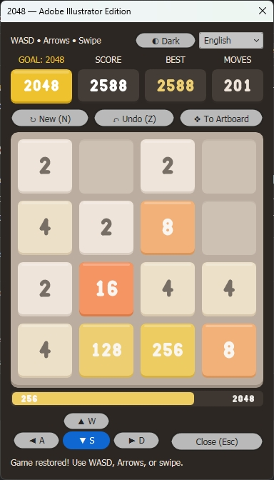 | **2048**<br>`2048.jsx` | Puzzle | Swipe gestures, tile merging, full game state restored between sessions |
| 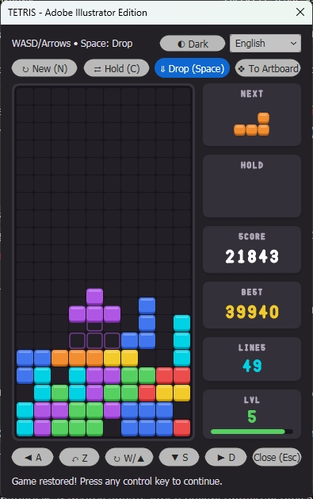 | **Tetris**<br>`Tetris.jsx` | Classic | 7-bag randomizer, wall kicks, ghost piece, hold/next preview, smooth falling piece |
| 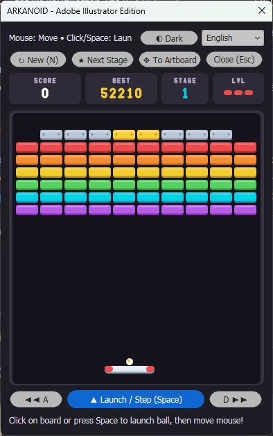 | **Arkanoid**<br>`Arkanoid.jsx` | Action | Continuous physics, 5 stages, 5 power-up capsules, lasers, mouse-driven paddle |
| 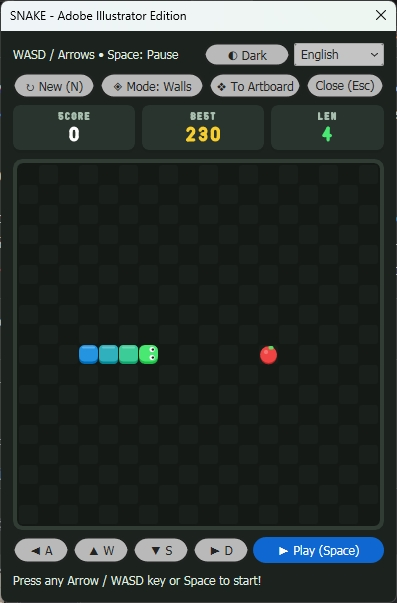 | **Snake**<br>`Snake.jsx` | Arcade | Turn queue, 3 arena modes (walls / portals / labyrinth), gradient body |
| 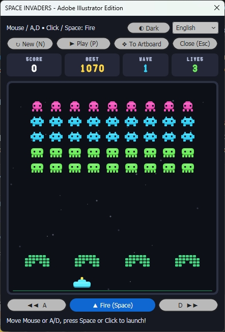 | **Space Invaders**<br>`SpaceInvaders.jsx` | Shooter | 5×9 swarm with two-frame animation, eroding bunkers, mystery UFO |
| 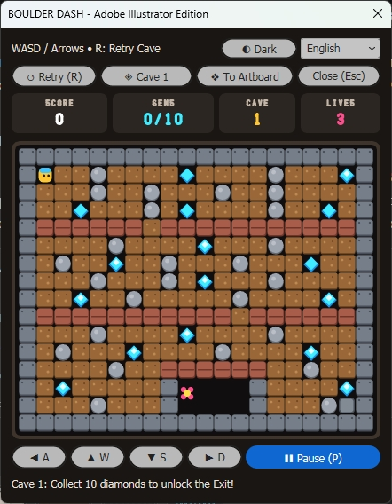 | **Boulder Dash**<br>`BoulderDash.jsx` | Logic | Cell gravity for boulders and gems, monster AI, 5 hand-built caves |
| 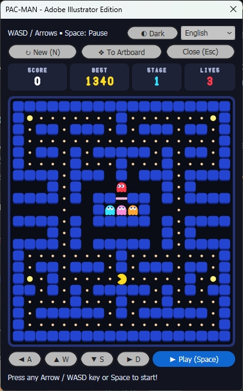 | **Pac-Man**<br>`PacMan.jsx` | Arcade | 19×21 maze, four ghosts with different personalities, frightened mode |
| 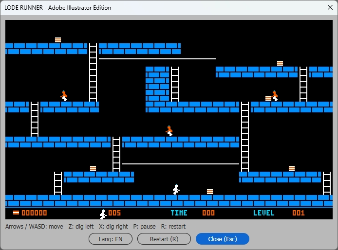 | **Lode Runner**<br>`LodeRunner.jsx` | Arcade | 150 authentic levels, laser digging with crumbling bricks, Doug Smith guard AI, Apple II running-bond masonry, retro HUD |
| 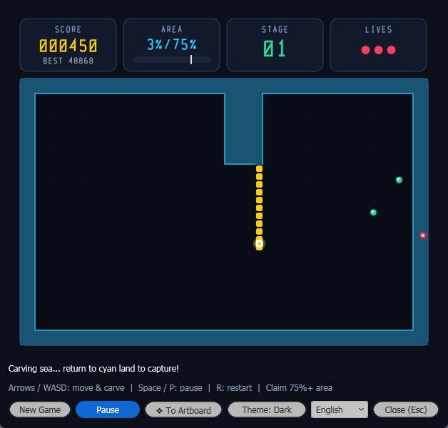 | **Xonix**<br>`Xonix.jsx` | Arcade | 52×34 flood-fill territory capture, sea orbs & land patrols, continuous 2px shoreline bevels, particle bursts |
| 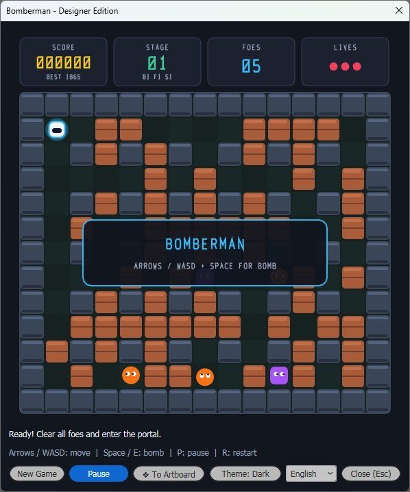 | **Bomberman**<br>`Bomberman.jsx` | Action | 15×13 maze, corner-assist steering, chain-reaction bombs, 4 power-ups, hidden portal & phantom AI |
| 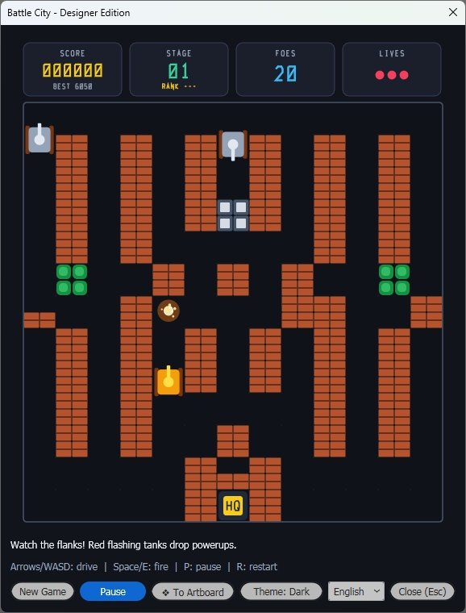 | **Battle City**<br>`BattleCity.jsx` | Action | 26×26 mini-tile arena, Eagle HQ fortress, brick/steel/water/ice/trees, 4 enemy tank types, 6 bonuses, 8 maps |
| 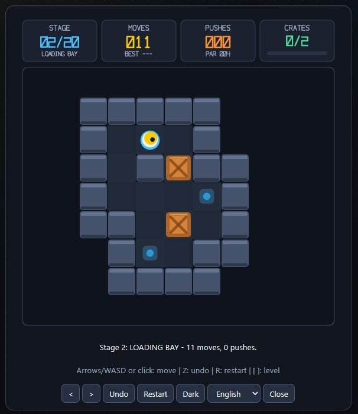 | **Sokoban**<br>`Sokoban.jsx` | Logic | 20 solver-verified crate puzzles, unlimited in-play Undo, BFS click-to-move, per-stage best moves/pushes saved |

## Quick start

### Option 1: Play in your browser

Open **[Relax Arcade on GitHub Pages](https://shafranek-js.github.io/ExtendScript-games-for-Illustrator/)** — all 12 games run directly on HTML5 Canvas with genre filters, local high-score badges (`localStorage`), per-game control legends, responsive fullscreen mode and touch D-pad support.

To build the browser bundle locally into `web/dist/`:

```powershell
node web/build.mjs
```

### Option 2: Run in Adobe Illustrator

The launcher is the entry point: one window with all twelve games, hotkeys `1`–`9`, `0`, `A`, `B`, a random pick, and shortcuts to the docs, the game folder and the runtime logs.

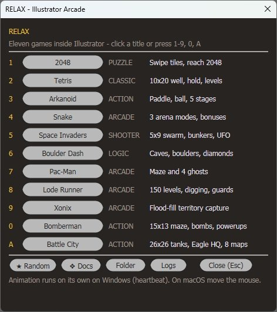

1. Download or clone this repository (**keep the folder intact — the games share `lib/`**).
2. In Illustrator open `File > Scripts > Other Script…` and pick **`Play Arcade.jsx`**.
3. Click a game title or press `1`–`9`, `0`, `A` or `B`. Closing a game brings the launcher back.

Running a single game directly works too: `File > Scripts > Other Script…` → e.g. `Tetris.jsx`, `Xonix.jsx`, `Bomberman.jsx` or `BattleCity.jsx`.

**Standalone single-file builds (zero dependencies):** Want just a single game of your choice without keeping the repository or `lib/` folder? Grab its `<Game>_standalone.jsx` directly from the [`standalone/`](standalone/) folder (e.g. `standalone/Tetris_standalone.jsx`, `standalone/Bomberman_standalone.jsx`, `standalone/BattleCity_standalone.jsx`) and run it via `File > Scripts > Other Script…` from anywhere — all `lib/` code is inlined inside each file.

**Controls:** arrows / WASD to move, `Space` for the primary action (`Z` / `X` to dig left / right in Lode Runner, bomb in Bomberman, fire in Battle City), `Esc` to close. Mouse steers in Arkanoid and Space Invaders; swipes and clicks work in 2048, Snake, Boulder Dash and Tetris.

## Play in a browser

The web launcher includes the same twelve games. The build reuses their rules, levels and vector drawing code. Canvas 2D draws the boards, browser input drives the controls, and progress is stored locally per browser and site address.

```powershell
node web/build.mjs
python -m http.server 8765 --bind 127.0.0.1 --directory web/dist
```

Open [Relax Arcade locally](http://127.0.0.1:8765/). Use a keyboard for games with keyboard controls. Illustrator artboard export is available in the Illustrator edition.

For online play, publish the contents of `web/dist/` to a static host. Rebuild after changing a game or the Illustrator launcher catalog.

## How it works

The full engineering notes — including the platform traps that shaped this code — are in **[EXTENDSCRIPT_GAME_DEV_GUIDE.md](EXTENDSCRIPT_GAME_DEV_GUIDE.md)**. Short version:

- **Windows heartbeat.** A PowerShell helper posts synthetic input to wake the modal dialog. The helper keeps posting while the game window exists, including after focus loss. Check actual background and minimized behavior on the target Illustrator build. The helper moves the real cursor only when the game window has focus and the cursor is inside the playfield.
- **Vector HUD.** Geometric glyphs give the game canvas consistent text placement. Standard ScriptUI labels use `statictext`.
- **ES3 only** — `var`, loops, no `let`/`const`, no `JSON`, no `Array#forEach`. A static gate enforces this.
- **Encoding matters.** Entry scripts containing non-ASCII text are UTF-8 **with BOM**; included `lib/` files are ASCII and BOM-less.

## Repository layout

```
Play Arcade.jsx             launcher: menu for all 12 games (1-9, 0, A, B, Random, Docs, Logs)
2048.jsx … Sokoban.jsx     twelve modular games (require lib/)
standalone/                self-contained single-file builds (*_standalone.jsx, zero dependencies)
web/                       browser arcade UI, Canvas 2D ScriptUI shim (host.js) and bundle builder (build.mjs)
lib/                       shared engine: drawing core, heartbeat, animation, persistence, i18n, diagnostics
tools/                 static gate, core tests, headless logic/render tests, level importer, standalone builder
screenshots/           UI captures used in this README
README.md              this file
TESTING.md             test plan: coverage matrix, cases A-01 … K-03, acceptance checklist
AGENTS.md              conventions for contributors
EXTENDSCRIPT_GAME_DEV_GUIDE.md  the engineering write-up
LICENSE                MIT
```

## Verification

```powershell
node tools/check.js              # ES3 syntax, #include resolution, UTF-8 BOM rules, i18n key parity
node tools/check.js --fix        # repair BOM problems in place
node tools/test-core.js          # drawing core, {0} substitution, save parsing, heartbeat generation
node tools/loderunner-headless.js # 37 headless tests for Lode Runner mechanics & vector rendering
node tools/xonix-headless.js      # 12 headless tests for Xonix flood-fill, patrols & vector rendering
node tools/bomberman-headless.js  # 12 headless tests for Bomberman blasts, powerups, foes & portal
node tools/battlecity-headless.js # 11 headless tests for Battle City terrain, HQ, upgrades & tanks
node tools/sokoban-headless.js    # 14 headless checks: solver, gameplay, UI lifecycle & rendering
node tools/make-standalone.js --all # rebuild all standalone single-file bundles in standalone/
node web/build.mjs                # bundle all 12 games into web/dist/ for GitHub Pages / local preview
```

The commands above run on Node alone. For checks in Illustrator, see [TESTING.md](TESTING.md) (Smoke run ≈ 25 min, Full run ≈ 2.5 h).

## Requirements and known limitations

- **Adobe Illustrator 2021+** — developed and tested on Illustrator 2026 (Windows, ES3 engine).
- **Windows** for autonomous animation. On macOS the heartbeat is unavailable: the game still runs, but advances only while the mouse moves, and the status bar says so.
- Corporate machines may block `powershell.exe -ExecutionPolicy Bypass` or `wscript.exe`; a synchronous launch failure can be reported in the dialog. Confirm autonomous motion after launch to catch failures later in the helper chain.
- The games use modal dialogs to keep their scripts active while the windows are open.
- Released under the MIT licence: free to reuse, modify and redistribute with attribution.

## Documentation

- **[EXTENDSCRIPT_GAME_DEV_GUIDE.md](EXTENDSCRIPT_GAME_DEV_GUIDE.md)** — the platform traps and the recipes that solve them (timer, vector font, batching, interpolation, encoding, export).
- **[TESTING.md](TESTING.md)** — test plan with case IDs and an acceptance checklist.
- **[AGENTS.md](AGENTS.md)** — coding conventions, encoding contract, review expectations.

## Licence

MIT — see [LICENSE](LICENSE). Take the code, the techniques and the write-up, fork them, ship them in your own scripts.
